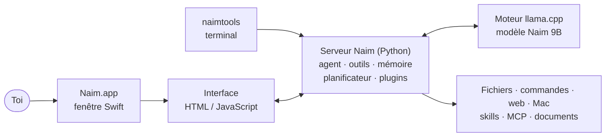

# Aide de Naim

Naim est un assistant de code et un agent pour ton Mac, qui tourne **entièrement en local**. Cette aide explique
comment l'utiliser, comment il fonctionne à l'intérieur, et comment le faire évoluer.

---

## 1. Bien démarrer

| Tu veux… | Fais… |
|---|---|
| Poser une question, discuter, faire un document | Mode **Chat** (il a aussi ses outils : fichiers, web, Mac) |
| Qu'il travaille dans un projet (code, apps, tests) | Mode **Agent** + choisir le **dossier** dans la barre de saisie |
| Qu'il parle à voix haute | Bouton **ondes** (conversation vocale) ; le micro seul sert à dicter |
| Qu'il agisse sans demander | Mode d'autorisation **⚡ Auto** (ou « Tout autoriser ») |
| Plus de réflexion pour un travail difficile | Bouton **Effort** à côté de la jauge : **Élevé** |
| Voir la place utilisée dans sa mémoire | Clic sur la **jauge** (fenêtre de contexte) |

**Au démarrage**, Naim prépare ses consignes (barre latérale : « Naim lit ses consignes… · 47 % »). La première fois
d'une journée, ou après un changement de skills ou de mémoire, il les lit (1 à 2 min par mode) puis les **garde sur
le disque** : aux ouvertures suivantes, elles sont rechargées en une seconde.

---

## 2. Commandes

### Dans la barre de saisie (tape « / »)

| Commande | Effet |
|---|---|
| `/plan <tâche>` | Explorer puis proposer un plan avant d'agir |
| `/init` | Analyser le projet et créer `NAIM.md` (ses règles et sa structure) |
| `/test` | Lancer les tests et corriger les échecs |
| `/review` | Relire les changements en cours |
| `/commit` | Faire un commit git propre |
| `/skill <nom> <tâche>` | Utiliser une skill précise |
| `/remember <fait>` | Ajouter à la mémoire de Naim |
| `/undo` | Annuler les dernières modifications de l'agent |
| `/web <question>` | Chercher sur le web |
| `/model <nom>` | Changer de modèle |
| `/agent` · `/chat` | Changer de mode |
| `/new` | Nouvelle conversation |
| `/compact` | Résumer le début de la conversation (plus rapide) |
| `/git` · `/mcp` · `/skills` · `/memory` | Ouvrir le panneau correspondant |
| `/planifier <demande>` | Programmer une tâche récurrente ou à une heure précise |
| `/help` | Toutes les commandes et raccourcis |

Les **plugins** ajoutent leurs propres commandes (ex. `/cartes`, `/televerser`, `/cobol`, `/algo`).

### Raccourcis clavier

| Raccourci | Effet |
|---|---|
| ⌘N | Nouvelle conversation |
| ⌘K | Palette de commandes |
| ⌘B | Masquer / afficher la barre latérale |
| ⌘J | Terminal |
| ⇧⌘F | Fichiers du projet |
| ⌘, | Personnaliser |
| ⌘+ / ⌘− / ⌘0 | Zoom |
| ⇧⌘C | Copier la dernière réponse |
| ⇧⌘A | Basculer Chat / Agent |
| ⇧⌘R | Raisonnement |
| ⇧⇥ | Mode d'autorisation suivant |
| Échap | Arrêter la réponse / fermer |

### Dans le Terminal du Mac

| Commande | Effet |
|---|---|
| `naim` | Ouvre l'application |
| `naim --web` | Interface dans le navigateur |
| `naimtools` | Naim dans le terminal (même agent, mêmes outils) |
| `naimtools` puis `/help`, `/mode`, `/contexte`, `/reset`, `/exit` | Aide, mode d'autorisation, mémoire de travail, oublier, quitter |

Dans `naimtools` : `\` + Entrée pour une nouvelle ligne, ⇧⇥ pour changer le mode d'autorisation.

---

## 3. Comment Naim fonctionne



### Un seul moteur, trois mémoires de lecture

Le modèle est chargé **une seule fois** (llama.cpp, port 8081). Le moteur a trois **emplacements** qui gardent
chacun ce qu'ils ont déjà lu, pour ne pas le relire :

| Emplacement | Sert à |
|---|---|
| 0 · Chat | les conversations du mode Chat |
| 1 · Agent | les tâches du mode Agent |
| dernier · Fond | la mémoire automatique, les résumés |

Le **calcul d'attention optimisé** (flash attention) est toujours actif : lecture ×1,7, écriture ×1,5 sur un M4.

### Le démarrage et sa mémoire sur le disque

Le modèle de Naim est **hybride** (couches SSM) : sa mémoire de lecture ne sait pas revenir en arrière. Au
démarrage, Naim lit donc **exactement** ses consignes (tout ce qui précède le premier message), puis enregistre cet
état dans `~/.naim/cache/slots/`. À l'ouverture suivante, il le **recharge** (moins d'une seconde) au lieu de tout
relire. Si les consignes changent (nouvelle skill, mémoire, nouveau jour), l'ancien fichier est **effacé** et
remplacé : une mémoire temporaire qui se purge seule.

### Ce que Naim relit à chaque conversation

Ses **consignes** (≈ 18 000 caractères) et la description de ses **outils** (≈ 15 000). Pour rester rapide :
- les **skills actives** qui se chargent par mots-clés sont seulement nommées ;
- la **bibliothèque de skills** et la **bibliothèque MCP** n'y coûtent qu'une ligne chacune ;
- les outils des **serveurs MCP** ne sont lus que quand une tâche en a besoin.

### Chat ou Agent : qui fait quoi

- **Chat** : il répond d'abord ; s'il faut agir (fichier, Mac, web), il utilise ses outils dans la même réponse.
  Les messages courts (« merci », « non », « c'est tout ») reçoivent une réponse rapide, sans outils.
- **Agent** : il comprend, **planifie** (liste de tâches), agit, **vérifie** (tests, page web, compilation, capture)
  et ne dit « terminé » qu'avec des preuves.
- Une **question pure** en mode Agent (« c'est quoi… ? ») reçoit une réponse sans rien modifier.

### Sa mémoire

| Mémoire | Contenu | Où |
|---|---|---|
| De la conversation | 32 000 jetons ; au-delà, Naim **résume le début** (les 2 derniers échanges restent mot pour mot) | en mémoire |
| D'une longue tâche | à 60 %, un **résumé rédigé** (décisions, forme des données, erreurs corrigées, reste à faire) remplace les anciennes étapes | + carnet `.naim/tache.md` |
| Brouillon | essais, conversions, pièces jointes de **cette** conversation | `~/Documents/Naim/Fichiers/Joints/<conversation>` |
| Durable | tes préférences et tes projets, d'une conversation à l'autre | `~/.naim` (mémoire) |
| Anciennes conversations | il peut les rechercher (« la dernière fois… ») | conversations |

« continue » (ou le bouton → en mode Agent) reprend la **dernière vraie demande**, avec son carnet et sa skill.

### Commandes longues

Une commande en cours s'affiche ouverte, avec son temps : « En cours · 12 s » et **Exécuter en arrière-plan**.
Un clic : elle continue derrière sans être coupée, Naim passe à la suite et est prévenu quand elle finit.

---

## 4. Skills, MCP, plugins, hooks

### Skills (méthodes)

| Où | Lues | Combien |
|---|---|---|
| **Skills actives** `~/.naim/skills` | à chaque conversation | garde-les peu nombreuses |
| **Bibliothèque** `~/.naim/skills-bibliotheque` | seulement au besoin | autant que tu veux (même des milliers) |

- **Ajouter** : Personnaliser › Skills › lien GitHub › Parcourir › Installer (ou **Tout installer**), en choisissant
  « Installer dans ». Plus de 30 d'un coup en actives : elles vont d'office dans la bibliothèque.
- **Automatique** : à chaque tâche sans skill active, Naim reçoit les 3 skills les plus proches de la bibliothèque
  (recherche français ↔ anglais) ; il peut aussi chercher lui-même (`chercher_skill`).
- **Vers la bibliothèque** : bouton sur chaque skill active.

### Serveurs MCP (outils externes)

| Où | Pour Naim |
|---|---|
| **Mes serveurs** `~/.naim/mcp.json` | listés (nom + rôle), outils chargés au besoin |
| **Bibliothèque MCP** `~/.naim/mcp-bibliotheque.json` | une ligne ; proposés quand ils correspondent, `chercher_mcp` |
| **Catalogue** | ajoutables par Naim lui-même, avec ta confirmation |

### Plugins

Un plugin (`~/.naim/plugins/<nom>/plugin.json`) apporte d'un coup des skills, des serveurs MCP, des commandes `/`,
des hooks et la liste de ses outils Homebrew. Personnaliser › Plugins : activer, installer les outils, ajouter depuis
GitHub ou un dossier, retirer (Corbeille). Fournis : **électronique** (Arduino, Raspberry Pi), **mainframe** (COBOL
vérifié par un hook, JCL, DB2, REXX, PL/I), **algorithmique** (pseudo-code).

### Hooks (automatismes)

Des commandes lancées à des moments précis : `~/.naim/hooks.json` (tous les projets), `<projet>/.naim/hooks.json`,
ou un plugin. Événements : `PreToolUse`, `PostToolUse`, `UserPromptSubmit`, `Stop`. La commande reçoit un JSON sur
son entrée ; code de sortie **2** = bloquer (ou renvoyer une remarque à Naim).

```json
{"hooks": {"PostToolUse": [{"matcher": "write_file|edit_file",
  "hooks": [{"type": "command", "command": "npx prettier --check \"$(jq -r .tool_input.path)\""}]}]}}
```

---

## 5. Sécurité et tes données

- **Autorisations** : Manuel (il demande), Accepter (fichiers sans demander), **Auto** (rien), Plan (il propose
  seulement). Toujours demandé : payer, mots de passe, envoyer un message, appeler, éteindre, Corbeille.
  Réponds aux demandes **à la voix** (« oui », « autorisé », « non », « autorise tout »).
- **Jamais** : vider la Corbeille, effacer un disque, `sudo`, toucher aux fichiers de Naim sans ton accord.
- **Lecture** partout dans ton dossier personnel (sauf `.ssh`, trousseau, mails…), **écriture** seulement dans le
  projet et son brouillon.
- **Corbeille** : tout ce que Naim retire y va (récupérable) ; « Tout supprimer définitivement » existe dans
  Personnaliser › Mémoire, avec trois confirmations.
- **Sauvegardes** : Personnaliser › Mémoire › Sauvegarder (conversations, mémoire, réglages, skills, MCP).

| Dossier | Contenu |
|---|---|
| `~/Library/Application Support/Naim` | conversations, réglages, l'application installée |
| `~/.naim` | modèle, skills, bibliothèques, plugins, mémoire, MCP, hooks, cache du démarrage |
| `~/Documents/Naim/Fichiers` | fichiers créés en Chat ; `Joints/` : pièces jointes et brouillons |
| `~/Documents/Sauvegardes Naim` | sauvegardes |

---

## 6. Pour les développeurs

### Lancer depuis les sources

```bash
git clone https://github.com/nebios7/naim && cd naim
bash install.sh          # installe (ou met à jour) l'app, l'environnement Python et les outils
naim --web               # l'interface dans le navigateur
naimtools                # l'agent dans le terminal
```

### Les fichiers

| Fichier | Rôle |
|---|---|
| `server.py` | serveur HTTP local (port 8765) : Chat, Agent, réglages, stockage, sauvegardes, démarrage |
| `naimtools.py` | l'**Agent** : boucle, outils, autorisations, mémoire de tâche ; aussi l'interface terminal |
| `llamacpp.py` | le moteur : lancement de llama.cpp, emplacements, mémoire de démarrage sur le disque |
| `extensions.py` | skills (choix automatique), serveurs MCP, mémoire, points de restauration |
| `skills_library.py`, `skills_pro.py`, `skills_extra/` | les skills fournies avec Naim |
| `skills_bibliotheque.py`, `mcp_bibliotheque.py` | les bibliothèques (recherche, proposition automatique) |
| `skill_hub.py`, `mcp_hub.py`, `mcp_catalog.py` | installation depuis GitHub, catalogue MCP |
| `plugins.py`, `plugins_builtin/` | les plugins |
| `hooks.py` | les hooks |
| `chatfiles.py`, `docs.py`, `diagrams.py` | fichiers du Chat, documents (PDF, Word…), schémas Mermaid |
| `computer.py`, `browser.py` | écran, clics, navigateur, simulateur iOS |
| `memory.py`, `learning.py`, `scheduler.py`, `mailer.py` | mémoire, apprentissage, tâches planifiées, e-mails |
| `web/index.html` | toute l'interface |
| `NaimApp.swift` et `*.swift` | la fenêtre native, la barre des menus, la dictée, le rendu PDF |

### Écrire une skill

`~/.naim/skills/<nom>/SKILL.md` (ou dans la bibliothèque) :

```markdown
---
name: ma-skill
description: Une phrase claire : ce qu'elle fait et quand l'utiliser (elle sert à la trouver).
---

# Méthode
1. Les étapes, concrètes, avec les commandes exactes.
2. Les pièges à éviter.
3. Comment vérifier le résultat avant de répondre.
```

Des fichiers à côté (scripts, modèles) sont lisibles par Naim ; cite leur chemin dans le texte.

### Écrire un plugin

```json
{
  "name": "mon-plugin", "version": "1.0", "description": "…",
  "skills": "skills",
  "triggers": {"ma-skill": "\\b(mot|autre mot)\\b"},
  "mcp": {"serveur": {"command": "npx", "args": ["-y", "paquet"]}},
  "commands": [{"cmd": "/faire", "description": "…", "prompt": "Ce que Naim doit faire", "mode": "agent"}],
  "tools": [{"cmd": "outil", "brew": "formule", "why": "à quoi il sert"}],
  "hooks": {"PostToolUse": [{"matcher": "write_file", "hooks": [{"type": "command", "command": "bash \"${PLUGIN_DIR}/verifier.sh\""}]}]}
}
```

### Conseils de code (ceux du projet)

- **Vérifier pour de vrai** avant de dire « c'est fait » : lancer, regarder, mesurer.
- Garder les **consignes courtes** : tout ce qui est lu à chaque conversation ralentit Naim.
- Ne **rien supprimer** des fichiers de l'utilisateur : Corbeille, ou dossier « Supprimés ».
- Une **règle de routage** (mots-clés) se teste sur des phrases qui doivent ET qui ne doivent pas déclencher.
- Interface : icônes au trait, pas d'emoji, pas d'information affichée deux fois.
- Commentaires en anglais dans le code, textes en français pour l'utilisateur.
